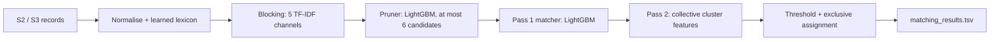

# Amazon ML Challenge 2026: Business Entity Resolution

Entry for the Amazon ML Challenge 2026. The task is to match every clean business record (Source 1) to its noisy duplicates in two other sources (Sources 2 and 3), across the US, India and France. The metric is macro F0.5 per Source-1 entity, so precision counts more than recall, and an empty prediction for a business with no matches counts as correct.

## Approach

Every S2/S3 record belongs to at most one S1 business, so the problem is solved record by record as an assignment: each record either picks its single best S1 or none.

1. **Normalisation**: Unicode and mojibake repair, accent folding, legal-form splitting, address-token maps, and a lexicon learned from the training truth pairs (the locked holdout is excluded from learning). Indic-script names are mapped to Latin via a learned token dictionary.
2. **Blocking** with five TF-IDF channels (name, address, combined, composite name x address, same-name key) to retrieve candidate S1 businesses per record. Composite and same-name keys were needed because at full scale common names tie on plain name similarity.
3. **Pruning** with a cross-fitted LightGBM to at most 6 candidates per record.
4. **Matching** with a two-pass LightGBM model on about 55 pair features. Pass 2 is *collective*: it adds features computed from the tentative cluster of records assigned to the same S1.
5. **Decision**: argmax S1 if probability is above a threshold tuned on out-of-fold macro F0.5, with false positives weighted x2 to mimic the denser decoys in the test set.



## Results

Measured on a locked holdout (10% of train S1 entities, never used for fitting or tuning):

| Stage | Macro F0.5 | Precision / Recall |
|---|---|---|
| Blocking + pruning | pair recall 0.9813 | |
| Pass 1 | 0.9810 | 0.995 / 0.955 |
| Pass 2 (collective) | **0.9851** | 0.997 / 0.965 |

These are local holdout numbers, not leaderboard scores. The earlier v1 pipeline scored 0.943 on the public leaderboard at its best.

Lesson from the project: a 10% development slice showed 0.997 blocking recall, but the full data dropped it to about 0.95, because common names tie and exceed document-frequency caps. Measuring at full scale and adding composite keys fixed it.

## Repository layout

| Path | Contents |
|---|---|
| `code/business_entity_resolution/` | Pipeline code, run scripts and its own [README](code/business_entity_resolution/README.md) with all steps |
| `Documentation_template.md` | Full write-up: methodology, features, error analysis |
| `submission/` | Packaged submission, including the final `submission_xe1_raw_pp_c5` |
| `amazon-ml-challenge-eda.ipynb` | Exploratory data analysis |
| `utils/` | Official submission validator |

## Reproduce

```bash
cd code/business_entity_resolution
python3 -m venv venv && venv/bin/pip install -r requirements.txt      # Python 3.12
PYTHON=venv/bin/python BER_WORKERS=8 ./run_v2.sh                      # about 4 h on 8 vCPU / 64 GB
```

The dataset is not included; place it as `dataset/train/*.tsv` and `dataset/test/*.tsv` next to `code/`.

## Notes

- CPU only; no external data and no pretrained models in the v2 pipeline.
